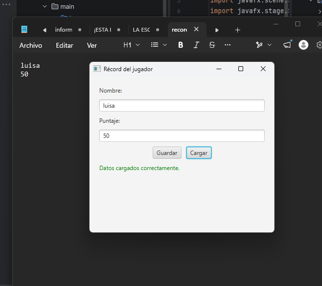
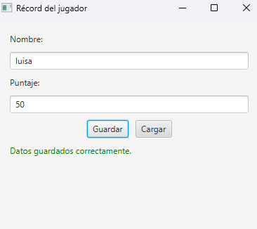
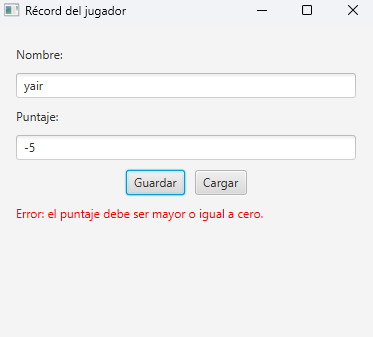
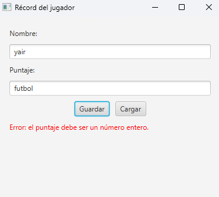
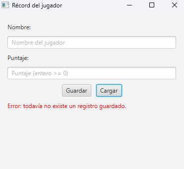

·Récord del jugador (JavaFX)

Aplicación JavaFX que guarda y consulta el nombre y el puntaje de un jugador
en el archivo de texto `record.txt`.

·Cómo ejecutarla
Requisitos: JDK 27 y Maven.
mvn javafx:run

·Estructura (MVC)
- **model/**: `Jugador` (datos) y `RepositorioJugador` (lectura/escritura con BufferedReader/BufferedWriter).
- **view/**: `VistaRecord` (interfaz, sin lógica).
- **controller/**: `ControladorRecord` (eventos de botones y validación de entradas).
- **app/**: `Main` (arranque).

· Formato de record.txt
Línea 1: nombre. Línea 2: puntaje.

· Pruebas realizadas

· Dudas que me surgieron y cómo las resolví
1. **¿Cómo configuro JavaFX?** → Usé Maven con la dependencia `javafx-controls` y el plugin `javafx-maven-plugin`.
2. **¿Por qué falla "JavaFX runtime components are missing" al darle Run?** → Hay que ejecutar con `mvn javafx:run`.
3. **¿Quién valida, el modelo o el controlador?** → El enunciado lo asigna al controlador.
4. **¿En qué formato guardo el archivo?** → Dos líneas: nombre y puntaje.
5. **¿Cómo reemplazo el registro anterior?** → Abriendo el escritor sin modo append, que trunca el archivo.
6. **¿Qué pasa si el archivo no existe, está vacío o dañado?** → Se captura la excepción y se informa en la etiqueta.
7. **¿Dónde se crea record.txt?** → En la carpeta desde donde se ejecuta (raíz del proyecto).